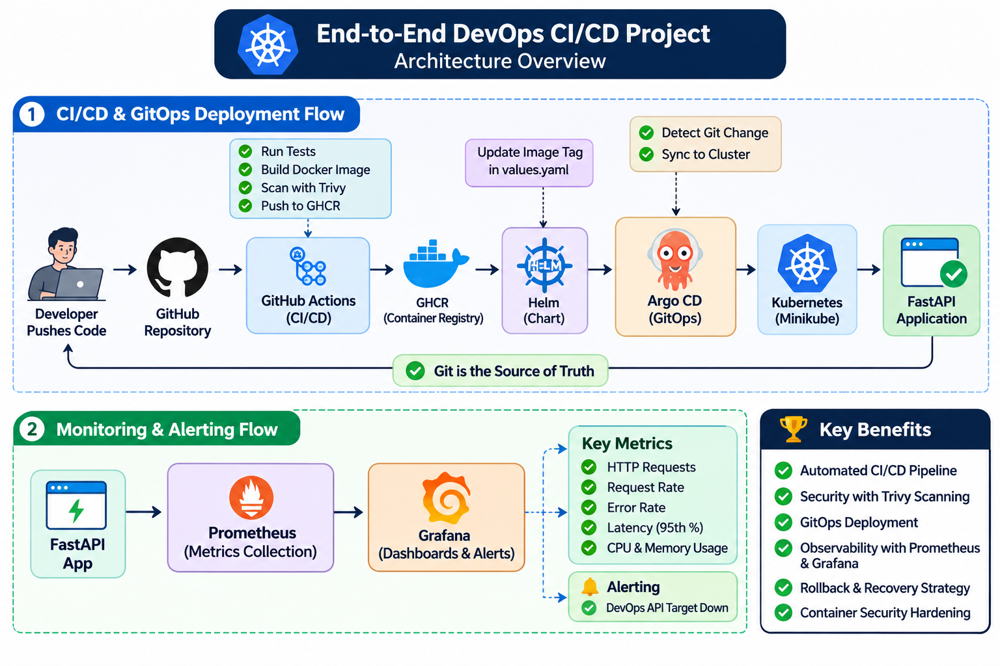
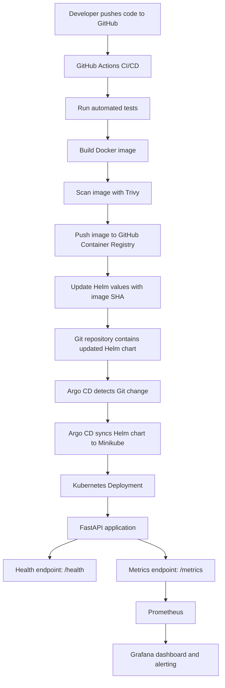

# End-to-End DevOps CI/CD Project

An end-to-end DevOps portfolio project demonstrating automated application testing, Docker image creation, security scanning, container image publishing, Kubernetes deployment, GitOps-based delivery, and application monitoring.

The project uses a Python FastAPI application and a locally hosted Kubernetes cluster to demonstrate a practical CI/CD and deployment workflow.

## Architecture



<details>
<summary>View Mermaid diagram source</summary>



</details>

## Technology Stack

| Area | Technology |
|---|---|
| Application | Python, FastAPI |
| Source Control | Git, GitHub |
| CI/CD | GitHub Actions |
| Containerization | Docker |
| Container Registry | GitHub Container Registry (GHCR) |
| Security Scanning | Trivy |
| Container Orchestration | Kubernetes, Minikube |
| Package Management | Helm |
| GitOps | Argo CD |
| Monitoring | Prometheus |
| Visualization and Alerting | Grafana |
| Application Metrics | prometheus-fastapi-instrumentator |

## Project Workflow

### 1. Application Development

- Developed a sample REST API using Python and FastAPI.
- Implemented the following endpoints:
  - `/` – Returns the application status.
  - `/health` – Provides application health information.
  - `/metrics` – Exposes application metrics for Prometheus.

### 2. Continuous Integration and Delivery

GitHub Actions automates the application delivery workflow.

The workflow performs the following steps:

1. Checks out the source code.
2. Installs application dependencies.
3. Executes automated tests using pytest.
4. Builds the Docker image.
5. Scans the image using Trivy.
6. Publishes the Docker image to GitHub Container Registry.
7. Updates the Helm values file with the newly generated image SHA.

**Trivy security gate:** The scan is configured to fail the workflow when HIGH or CRITICAL vulnerabilities with available fixes are detected. Unfixed vulnerabilities are ignored by the configured scan.

### 3. Docker and Container Registry

- Created a Dockerfile to containerize the FastAPI application.
- Built Docker images through GitHub Actions.
- Published images to GitHub Container Registry (GHCR).
- Used immutable Git commit SHA tags to identify application image versions.

### 4. Kubernetes Deployment with Helm

- Used Minikube to create a local Kubernetes environment.
- Created a reusable Helm chart for the FastAPI application.
- Managed deployment configuration through `values.yaml`.
- Configured Kubernetes resource requests and limits.
- Implemented readiness and liveness probes using the `/health` endpoint.
- Applied container security settings:
  - Non-root user execution.
  - Dropped Linux capabilities.
  - Disabled privilege escalation.
  - RuntimeDefault seccomp profile.

### 5. GitOps with Argo CD

- Configured Argo CD to monitor the GitHub repository.
- Connected Argo CD to the Helm chart.
- Enabled automated synchronization, pruning, and self-healing.
- Used Git as the source of truth for Kubernetes application configuration.
- Verified application synchronization and health through the Argo CD interface.

### 6. Monitoring with Prometheus and Grafana

Integrated Prometheus and Grafana to monitor application and container performance.

**Prometheus integration:**

- Exposed FastAPI application metrics through `/metrics`.
- Configured a Kubernetes ServiceMonitor to discover and scrape application metrics.
- Configured a 30-second scrape interval.

**Grafana dashboard:**

Created a dashboard named `DevOps API Monitoring` with the following panels:

1. Total HTTP Requests.
2. HTTP Request Rate.
3. HTTP Error Rate.
4. API Response Latency (p95).
5. Kubernetes Container CPU Usage.
6. Kubernetes Container Memory Usage.

**Alerting:**

- Created a Grafana alert rule named `DevOps API Target Down`.
- Configured the alert to detect when the application monitoring target becomes unavailable.
- Tested the alert state transition from Firing to Normal.

### 7. Rollback and Recovery

Tested application rollback and recovery using Git-based configuration changes.

The rollback process:

1. Identify the previously working application image SHA.
2. Update the image tag in the Helm `values.yaml` file to the known-good version.
3. Commit and push the change to GitHub.
4. Argo CD detects the change and synchronizes the Helm chart.
5. Kubernetes performs the application rollout.
6. Verify pod status and application health.

**Tested image versions:**

- Previous version: `084d940b537392f5e52fec3f7d761013f18d12eb`
- Restored version: `0cd284da10d41c13e84814a7aaff932b7372f6b8`

Successfully tested rollback to the previous image and restored the latest image. Application health was verified after both deployments.

## Repository Structure

```text
devops-end-to-end-cicd/
│
├── .github/
│   └── workflows/              # GitHub Actions CI/CD workflow
│
├── app/                         # FastAPI application
│
├── argocd/                      # Argo CD application manifests
│
├── docs/
│   └── images/
│       └── project-architecture.png
│
├── helm/
│   └── devops-api/              # Helm chart
│
├── k8s/                         # Kubernetes manifests
│
├── tests/                       # Automated application tests
│
├── .dockerignore
├── .gitignore
├── Dockerfile
├── requirements.txt
└── README.md
```

## Running the Application Locally

The project uses Minikube as its local Kubernetes environment.

### Prerequisites

- Git
- Docker Desktop
- Minikube
- kubectl
- Helm

### Access the Application

Forward the Kubernetes service port:

```powershell
kubectl port-forward svc/devops-api -n devops-api 8000:8000
```

Access the application:

| Endpoint | URL |
|---|---|
| Application | http://localhost:8000/ |
| Health Check | http://localhost:8000/health |
| Prometheus Metrics | http://localhost:8000/metrics |

### Access Argo CD

```powershell
kubectl port-forward svc/argocd-server -n argocd 8080:443
```

Open:

```text
https://localhost:8080
```

### Access Prometheus

```powershell
kubectl port-forward svc/monitoring-kube-prometheus-prometheus -n monitoring 9090:9090
```

Open:

```text
http://localhost:9090
```

### Access Grafana

```powershell
kubectl port-forward svc/monitoring-grafana -n monitoring 3000:80
```

Open:

```text
http://localhost:3000
```

## Key DevOps Practices Demonstrated

- Automated application testing.
- Docker image build and publishing.
- Container vulnerability scanning.
- Immutable image tagging using Git commit SHA.
- Reusable Helm-based Kubernetes deployments.
- GitOps-based continuous delivery using Argo CD.
- Kubernetes health checks and resource management.
- Container security configuration.
- Application and container monitoring.
- Grafana alerting.
- Git-based rollback and recovery.

## Project Scope

This is a hands-on portfolio project developed and tested using a local Minikube Kubernetes cluster.

GitHub Actions and GitHub Container Registry are used for the CI/CD workflow and image publishing. Argo CD manages application deployment into the local Kubernetes environment.

The project demonstrates practical DevOps concepts and is not presented as a production AWS deployment.

## Author

**Sakthi Manikandan A**

GitHub: [Sakthi-Manikandan](https://github.com/Sakthi-Manikandan)
