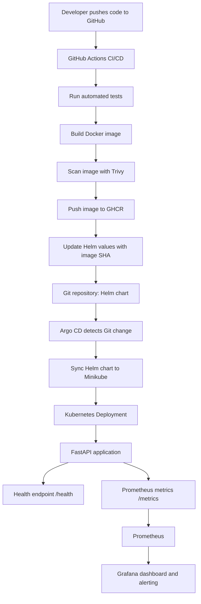

# End-to-End DevOps CI/CD Project

An end-to-end DevOps portfolio project that automates testing, container image building, vulnerability scanning, publishing, and GitOps-based Kubernetes deployment of a FastAPI application.

## Project Overview

This project demonstrates an automated CI/CD workflow using GitHub Actions, Docker, Trivy, GitHub Container Registry (GHCR), Kubernetes, Helm, and Argo CD.

Application metrics are collected using Prometheus and visualized through Grafana dashboards and alerting.

The application is deployed to a local Kubernetes cluster running on Minikube.

## Architecture



## Technology Stack

| Area | Technology |
|---|---|
| Application | Python, FastAPI |
| CI/CD | GitHub Actions |
| Containerization | Docker |
| Vulnerability Scanning | Trivy |
| Container Registry | GitHub Container Registry (GHCR) |
| Container Orchestration | Kubernetes, Minikube |
| Deployment Configuration | Helm |
| GitOps | Argo CD |
| Metrics Collection | Prometheus |
| Monitoring and Visualization | Grafana |

## CI/CD Workflow

1. Code changes are pushed to the GitHub repository.
2. GitHub Actions executes automated tests.
3. A Docker image is built.
4. Trivy scans the image for vulnerabilities. The configured gate fails on HIGH and CRITICAL vulnerabilities according to the scan settings.
5. The Docker image is published to GHCR using the Git commit SHA as its tag.
6. The workflow updates the image tag in the Helm values file.
7. Argo CD detects the Git change and synchronizes the Helm chart.
8. Kubernetes deploys the application and uses readiness and liveness probes to check application health.

## Kubernetes and Helm

The FastAPI application is deployed using a Helm chart located at `helm/devops-api`.

The deployment configuration includes:

- Configurable replica count and container image tag.
- CPU and memory requests and limits.
- Readiness and liveness probes using `/health`.
- Non-root container execution using UID/GID 10001.
- Disabled privilege escalation.
- Dropped Linux capabilities.
- `RuntimeDefault` seccomp profile.
- ClusterIP service for internal application access.
- ServiceMonitor resource for Prometheus scraping.

## GitOps with Argo CD

Argo CD continuously monitors the repository's Helm chart and reconciles the Kubernetes cluster with the desired state stored in Git.

Automated synchronization is configured with pruning and self-healing.

Git serves as the source of truth for deployment configuration.

## Monitoring and Alerting

Prometheus scrapes application metrics exposed at `/metrics` through a Kubernetes ServiceMonitor.

The Grafana dashboard, **DevOps API Monitoring**, includes:

- Total HTTP requests by handler.
- HTTP request rate.
- HTTP error rate.
- 95th percentile request latency.
- Kubernetes container CPU usage.
- Kubernetes container memory usage.

A Grafana alert rule, **DevOps API Target Down**, monitors the availability of the application target.

## Rollback Strategy

The primary rollback strategy is Git-based rollback through the Helm image tag.

### Rollback procedure

1. Identify the last known-good image SHA.
2. Revert the image-tag change in Git or commit the known-good image tag to the Helm values file.
3. Argo CD detects the desired-state change and synchronizes it.
4. Kubernetes rolls out the previous application image.
5. Verify Argo CD synchronization and health, Deployment rollout status, pod readiness, and the `/health` endpoint.

### Rollback validation

A controlled rollback and recovery test was successfully performed.

| Stage | Image SHA | Result |
|---|---|---|
| Original deployment | `0cd284da10d41c13e84814a7aaff932b7372f6b8` | Healthy |
| Rollback | `084d940b537392f5e52fec3f7d761013f18d12eb` | Healthy |
| Recovery | `0cd284da10d41c13e84814a7aaff932b7372f6b8` | Healthy |

Both rollback and recovery were verified through Kubernetes deployment status and application health checks.

`kubectl rollout undo` is available as a secondary manual rollback mechanism. Git-based rollback is preferred because Argo CD reconciles the cluster from Git.

## Repository Structure

```text
devops-end-to-end-cicd/
├── .github/
│   └── workflows/          # CI/CD workflow
├── app/                    # FastAPI application
├── argocd/                 # Argo CD application manifests
├── helm/
│   └── devops-api/         # Helm chart
├── k8s/                    # Kubernetes manifests
├── tests/                  # Automated tests
├── .dockerignore
├── .gitignore
├── Dockerfile
├── requirements.txt
└── README.md
```

## Local Access

The project runs on Minikube.

### FastAPI Application

```powershell
kubectl port-forward svc/devops-api -n devops-api 8000:8000
```

- API: http://localhost:8000/
- Health Check: http://localhost:8000/health
- Prometheus Metrics: http://localhost:8000/metrics

### Prometheus

```powershell
kubectl port-forward svc/monitoring-kube-prometheus-prometheus -n monitoring 9090:9090
```

- Prometheus UI: http://localhost:9090

### Grafana

```powershell
kubectl port-forward svc/monitoring-grafana -n monitoring 3000:80
```

- Grafana UI: http://localhost:3000

## Key DevOps Practices Demonstrated

- Automated CI pipeline with test execution.
- Container image building, vulnerability scanning, and registry publishing.
- Immutable image tagging using Git commit SHA.
- Helm-based Kubernetes deployment configuration.
- GitOps continuous delivery using Argo CD.
- Kubernetes health probes and resource management.
- Prometheus application metrics and Grafana dashboards.
- Grafana availability alerting.
- Git-based rollback and recovery validation.
- Container security hardening.

## Scope and Environment

This is a learning and portfolio project deployed to a local Minikube cluster.

It demonstrates end-to-end DevOps workflows in a local environment and does not claim production cloud deployment.

## Author

**Sakthi Manikandan**

GitHub: [Sakthi-Manikandan](https://github.com/Sakthi-Manikandan)
